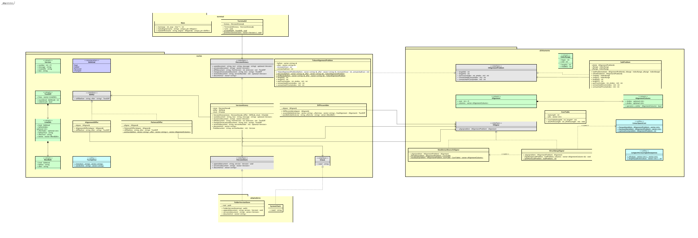

# G58_Programacao_Dinamica_PA_26.2

**Número da Lista**: 58<br>
**Conteúdo da Disciplina**: Programação Dinâmica<br>
**Nome da aplicação**: Versionador de arquivos<br>

## Alunos

| Matrícula | Aluno |
| -- | -- |
| 231011696 | Luiz Guilherme Morais da Costa Faria |

## Apresentação

(adicionar)

## Sobre


## Instalação

**Linguagem**: C++17 <br>
**Compilador**: Clang ou GCC<br>
**Build**: CMake 3.20 ou superior<br>
**Testes**: GoogleTest 1.15.2, com o GoogleMock, baixado automaticamente pelo CMake na primeira configuração (precisa de internet)<br>
**Dados**: nenhum arquivo externo

No terminal, dentro da pasta do projeto:

```bash
cmake -S . -B build-release -DCMAKE_BUILD_TYPE=Release
cmake --build build-release
```

## Uso

```bash
(adicionar)
```

## Algoritmos e modelagem

### Arquitetura: portas e adaptadores

O núcleo (`nucleo` e `alinhamento`) só conhece interfaces. O `alinhamento` não sabe nada de texto: recebe um problema com tamanhos e custos e devolve o alinhamento de custo mínimo. Quem traduz linhas e palavras em custos é o `TokenAlignmentProblem`, do `nucleo`.

| Interface | Papel | Implementação |
| -- | -- | -- |
| `IDiffer` | Compara dois textos e devolve o `TextDiff`, por linha e por palavra | `AlignmentDiffer`, usada pela `TerminalUI`; `PatienceDiffer` |
| `IAligner` | Alinha duas sequências com o menor custo | `NeedlemanWunschAligner`; `HirschbergAligner` |
| `IAlignmentProblem` | Informa ao alinhador os tamanhos das sequências e o custo de cada coluna | `TokenAlignmentProblem`; `SubProblem` |
| `IVersionHistory` | Guarda e compara as versões de cada documento | `VersionHistory` |
| `IVersionStore` | Lugar onde as versões ficam guardadas | `FolderVersionStore` |
| `IClock` | Data e hora de cada versão | `SystemClock` |

O `main` é o único lugar que conhece as classes concretas: ele monta as peças e as entrega ao núcleo. Isso permite trocar qualquer peça sem mexer no resto. Os testes aproveitam isso com os mocks do GoogleMock (`tests/Mocks.hpp`), um para cada interface: o `DiffAssembler`, por exemplo, pode ser testado com um `MockAligner` que devolve o alinhamento que o teste mandar. O [diagrama de componentes](#diagrama-de-componentes) mostra essas ligações.

## Organização do código

| Pasta ou arquivo | Responsabilidade |
| -- | -- |
| `estrutura/terminal/main.cpp` | Ponto de entrada: monta o `NeedlemanWunschAligner`, o `AlignmentDiffer` e a `TerminalUI` |
| `estrutura/terminal/` | `TerminalUI`: laço de comandos e impressão do diff |
| `estrutura/nucleo/` | `AlignmentDiffer`, `DiffAssembler`, `TokenAlignmentProblem`, `TextSplitter`, a interface `IDiffer`, as structs `TextDiff`, `LineEdit` e `WordEdit` e o enum `EditKind`. Extras: `PatienceDiffer`, `VersionHistory`, a struct `Version` e as interfaces `IVersionHistory`, `IVersionStore` e `IClock` |
| `estrutura/alinhamento/` | `NeedlemanWunschAligner`, `CostTable`, as interfaces `IAligner` e `IAlignmentProblem` e as structs `Alignment` e `AlignmentColumn`. Extras: `HirschbergAligner`, `LinearSpaceCost`, `SubProblem`, `IndexRange` e `LongestIncreasingSubsequence` |
| `estrutura/adaptadores/` | Extras: `FolderVersionStore` (versões guardadas numa pasta) e `SystemClock` |
| `estrutura/NotImplemented.hpp` | Corpo provisório dos métodos ainda não implementados |
| `tests/` | Suíte de testes, com um arquivo por classe, e os mocks das interfaces (`Mocks.hpp`) |
| `docs/astah/` | Projeto do Astah |
| `docs/diagramas/` | Diagramas exportados do Astah |

## Diagramas UML

Os diagramas foram feitos no Astah. O projeto fica em [`docs/astah/`](docs/astah/), e as imagens exportadas, em [`docs/diagramas/`](docs/diagramas/). Clique num diagrama para abri-lo em tamanho real; em SVG, ele pode ser ampliado sem perder a nitidez.

### Diagrama de classes

As classes dos quatro pacotes (`terminal`, `nucleo`, `adaptadores` e `alinhamento`), com atributos, métodos e relações. As interfaces estão em cinza, as structs em verde, o enum `EditKind` em roxo e os utilitários (`TextSplitter`, `LinearSpaceCost` e `LongestIncreasingSubsequence`) em azul. O diagrama inclui as classes dos extras: o histórico de versões, o patience diff e o Hirschberg.

[](docs/diagramas/class-v4-pa-t4.svg)

### Diagrama de componentes

(adicionar)

### Diagramas de sequência

(adicionar)

### Diagramas de atividades

(adicionar)

## Experimentos e comparação

(adicionar)

## Screenshots

(adicionar)

### Exemplo de execução

```text
(adicionar)
```

### Diagramas

Os diagramas UML (classes, componentes, sequência e atividades) estão na seção [Diagramas UML](#diagramas-uml).

## Validação

```bash
cmake --build build-release
ctest --test-dir build-release --output-on-failure
```

O projeto está sendo desenvolvido com TDD: cada teste é escrito antes do código que ele testa, com o GoogleTest. Cada classe tem o seu arquivo de teste em `tests/`. Para testar uma classe sem depender das outras, os testes usam os mocks do GoogleMock em `tests/Mocks.hpp`, um para cada interface.

```bash
(adicionar)
```

| Camada | Testes | O que cobre |
|--------|-------:| -- |
| (adicionar) | | |

(adicionar)

## Outros

(adicionar)


